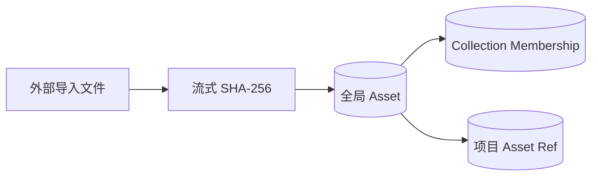

# 全局素材库

## 目标

素材库负责回答三个问题：

1. 这是不是同一个内容？
2. 受管原始文件现在是否完整？
3. 用户如何组织并导出它？

它不负责替代项目画布。导入只创建一份全局受管原始副本；是否把素材关联到项目是后续独立操作。集合和标签通过关系组织素材，不再复制文件。

## 独立存储

全局素材库使用独立 SQLite 数据库。项目数据库只保存素材 ID 引用。



这样同一个素材可以被多个项目引用，二进制内容只在全局资料库保存一次。

## 内容身份与去重

- 导入时以流式方式计算整个源文件的 SHA-256。
- 内容哈希是去重身份，不是文件名、路径、修改时间或缩略图哈希。
- 相同 SHA-256 对应一个全局 Asset；重复导入复用已有记录和受管文件。
- 不同内容即使同名，也必须是不同素材。
- 哈希冲突不应靠覆盖处理；如果文件大小或后续校验矛盾，应停止合并并报告异常。
- 受管存储键固定为 `objects/<哈希前两位>/<完整 SHA-256>`，只能从规范化哈希推导，不能接收外部路径或文件名。

大文件哈希必须可取消，不把整个文件读入内存。缩略图和解析元数据都是可重建缓存，不参与内容身份。

## 建议的概念实体

- `Asset`：ID、SHA-256、字节数、媒体类型、由哈希推导的受管存储键、原始文件名和用户元数据；
- `AssetMetadata`：尺寸、时长、EXIF 等可重建信息；
- `Collection`：用户命名的虚拟集合；
- `CollectionMembership`：素材与集合的多对多关系；
- `Thumbnail`：派生缓存版本和位置。

删除集合只删除成员关系，不删除受管文件。移除素材记录与删除受管文件是两个明确动作，不能共用一个含糊的“删除”按钮。

## 受管副本完整性

资料库可能被手工移动、磁盘可能离线，或受管文件可能损坏。完整性检查失败时：

- 保留素材 ID、哈希、元数据和项目引用；
- 标记受管 Asset 不可用，不把素材静默删除；
- 允许用户重新选择一份文件进行修复；
- 用 SHA-256 验证修复内容，哈希不同则拒绝覆盖；
- 恢复时仍写入受管目录，不把外部路径变成长期依赖。

## 虚拟集合

集合只表达组织关系：

- 一个素材可以属于多个集合；
- 加入集合不移动或复制受管文件；
- 集合可以独立改名；首版不保存成员手工排序，按查询规则稳定展示；
- 项目引用素材，不引用“集合里的某一份副本”。

搜索、筛选与智能集合可以建立在相同素材记录上，不应产生第二套素材身份。

## Eagle 式源文件导出

导出目标是可携带、可检查的普通文件结构，而不是私有数据库快照。

建议输出：

```text
export/
  manifest.json
  Collection A/
    original-name.jpg
  Collection B/
    original-name--a1b2c3d4.png
```

规则：

- 复制受管的原始字节，不把缩略图冒充源文件；
- 清理路径分隔符和平台非法字符；
- 同目录重名时使用稳定哈希短后缀，不静默覆盖；
- `manifest.json` 记录素材 ID、完整 SHA-256、原始文件名、导出相对路径和集合；
- 导出后可按哈希验证；
- 缺失受管文件进入失败清单，不能用空文件或缓存替代；
- 一个素材属于多个集合时，首版可选择复制到各集合，并在清单中明确；后续如采用硬链接，必须有跨平台降级策略。

“Eagle 式”描述的是用户可理解的源文件导出体验，不代表兼容或复刻 Eagle 的私有数据库格式。

首版只提供这一种 `source-files` 导出。项目包、数据库快照或缩略图导出都不进入同一个端口；源文件导出请求只接收 `assetIds`，目标目录选择由桌面基础设施适配器负责。

## 隐私与安全

- EXIF 可能包含位置与设备信息，导出时应明确保留还是移除；
- 外部导入路径和受管存储键不能直接进入公开日志；
- 解析器必须把媒体文件视为不可信输入；
- BYOK 密钥、提示词历史和 AI 响应不属于素材元数据；
- 任何自动删除源文件的功能都必须有可恢复策略和明确确认。
