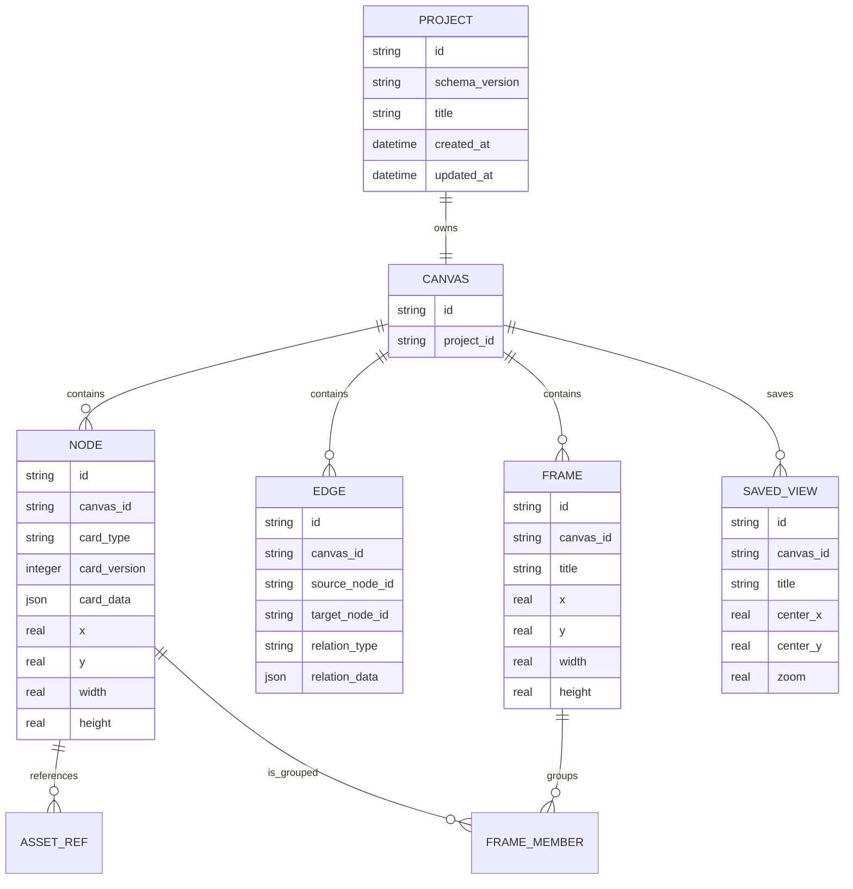

# 数据模型

## 基本关系



这是概念模型，不是首版 SQL 的逐字承诺。字段命名可以随实现校正，但数据所有权和关系不能被 UI 便利性篡改。

## 一项目一画布，多根节点

项目与画布是一对一关系。当前 walking skeleton 只保存 `id = "current"` 的单行工作区快照；当 M1 演进为多项目仓储时，SQLite 的 `project_id` 必须是唯一键，从存储层保证一个项目最多只有一条画布记录。`CanvasDocument.id` 与 `projectId` 仍是两个独立标识，不要求字符串相等。

`NODE` 不需要虚构一个“总根节点”。只有 `expansion` 边表达展开父子关系：每个节点最多一条父边，且不得成环，因此整体是一片森林而不是一棵树。没有 `expansion` 入边的节点自然就是根节点；多根节点是正常状态。零节点画布合法，非空画布必须至少存在一个根节点。

其他类型的边只表达节点间关系，不受树约束。不要把所有边解释为父子关系，也不要用数据库外键强迫整张画布成为一棵树。

这些结构约束统一由 `validateCanvasDocument()` 检查，包括：

- 文档及各实体 ID 非空，集合内 ID 唯一；
- Edge、FrameMember 与 SavedView 的引用目标存在；
- 一个节点最多属于一个 Frame，重复成员记录非法；
- `expansion` 边禁止多父和成环，并允许多个根。

编辑器、SQLite 适配器和导入流程不得各自复制一套判断。它们只消费核心验证结果，避免 UI 特殊分支演变成第二套数据模型。

## Frame

Frame 是持久化的空间分组实体，不是节点父子树。

- 几何范围属于 Frame。
- 成员关系通过 `FRAME_MEMBER` 表达。
- 移动 Frame 是否带动成员，由领域命令统一决定。
- 节点最多属于一个 Frame，由核心验证器强制；如果真实用例要求多归属，必须先升级数据模型与迁移。

不要同时用“几何包含”“X6 parent”与成员表各自判断归属。持久化成员关系是唯一真相，几何命中只是交互建议。

## Saved View

Saved View 保存导航状态：

- 视口中心；
- 缩放比例；
- 可选的焦点节点或 Frame；
- 稳定排序。

它不复制节点，不创建第二张画布，也不保存临时面板开关。删除 Saved View 不得删除任何画布内容。

## 卡片数据

每个节点包含稳定外壳和插件私有负载：

```ts
type CardRecord = {
  id: string;
  type: string;
  contentVersion?: number;
  content: unknown;
  position: { x: number; y: number };
  size: { width: number; height: number };
};
```

- 核心只理解稳定外壳。
- 插件拥有 `content` 的 schema 与迁移。
- `type` 使用稳定命名空间，例如 `mrcarlsama.shot`。
- 读取未知类型时保留 `content` 的原始可序列化表示。
- 保存未知类型不得重写、清空或自动“升级”其数据。

## 标识与时间

- 持久化实体使用应用生成的不可变 ID，不依赖 SQLite 自增序号作为跨文件身份。
- 时间以 UTC 存储，显示时转换为本地时区。
- 排序依赖显式排序键，不依赖行插入顺序。
- 删除策略需要逐实体定义；不能靠级联删除猜测用户意图。

## 事务与迁移

- 一个用户动作涉及多张表时必须在同一事务内完成。
- 每个数据库记录独立的 schema version。
- 迁移必须可重复验证，并先备份或保证原子替换。
- 不允许“打开旧项目失败就新建空库”这种数据丢失式降级。
- 项目数据库迁移与全局素材数据库迁移互不绑定。

## 项目与素材的连接

项目仅保存稳定的素材引用 ID 和必要的显示快照，不拥有全局素材记录。素材内容身份、受管存储键和元数据属于全局素材库；外部导入路径不成为项目依赖。项目在另一台机器打开时，引用可以显示为“未解析”，但画布结构仍必须可打开和编辑。
