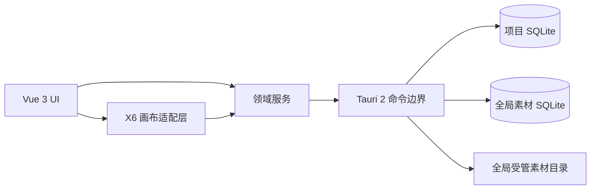

# 架构总览

## 一句话定义

MrCarlsama Canvas 是一个本地优先的桌面无限画布：项目保存策划关系，全局素材库管理源文件身份，编译时卡片插件负责呈现不同领域信息。

## 系统边界

X6 是渲染和交互引擎，不是数据模型。Vue 组件也不是持久化边界。所有持久化操作必须通过明确的领域命令进入 Tauri 后端。

## 核心数据流

### 打开项目

1. Tauri 打开并迁移项目 SQLite。
2. 领域层读取项目、节点、边、Frame 和 Saved View。
3. Card Registry 根据 `card_type` 选择已编译的卡片实现。
4. 未知 `card_type` 以占位卡呈现，原始数据保持不变。
5. 画布适配层把领域快照投影给 X6。

### 修改画布

1. UI 产生领域命令，而不是直接写数据库。
2. 领域层校验标识、关系和版本。
3. 后端在事务中持久化。
4. 成功后更新内存投影；失败则保留原状态并报告错误。

不要并行维护“X6 一份真相、Pinia 一份真相、SQLite 又一份真相”。持久化领域状态只有一套；其他都是可重建投影。

## 模块责任

| 模块           | 负责                                | 不负责               |
| -------------- | ----------------------------------- | -------------------- |
| Desktop app    | 生命周期、窗口、菜单、平台集成      | 定义卡片私有业务字段 |
| Canvas core    | 节点/边/Frame/Saved View 的稳定契约 | 摄影领域文案         |
| X6 adapter     | 渲染、命中、缩放和平移映射          | 持久化真相           |
| Asset library  | 内容身份、元数据、集合和导出        | 项目画布布局         |
| Card SDK       | 卡片契约、注册和迁移接口            | 动态下载并执行代码   |
| Built-in cards | 摄影策划领域能力                    | 修改核心存储规则     |

## 进程与权限

- WebView 不直接访问任意文件系统。
- Tauri 命令采用允许列表和结构化参数。
- 项目数据库与全局素材数据库分开打开、分开迁移。
- 外部文件只在导入时读取，校验后复制到全局受管素材目录。
- BYOK 凭据将来只能存入系统凭据设施或等价安全存储，不能进入项目数据库。
- 导入内容一律视为不可信输入。

## 首阶段明确不做

- 云同步、多人协作和账号系统；
- 运行时插件市场或任意脚本执行；
- AI 自动生成作为保存或打开项目的前置条件；
- 多画布项目；
- 为未来 SaaS 提前引入服务端领域模型。

这些能力不是永远禁止，而是必须等本地数据模型和真实工作流稳定后再基于证据引入。
